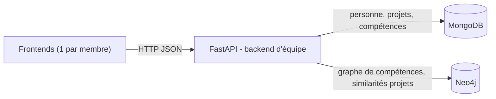
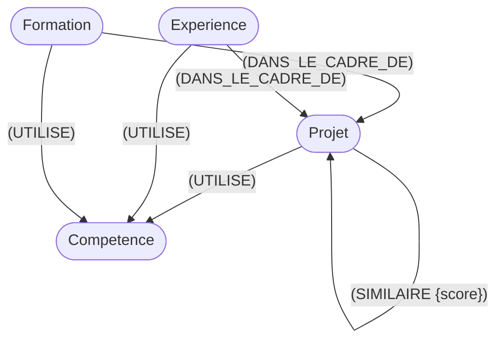

# 🧠 ARCHITECTURE - Équipe Window

> **Jalon 1** : ce document est votre **spécification**. Il doit être **complet** : toute l'équipe va coder dessus.
> Toutes les sections sont obligatoires. Remplacez **tous** les `TODO` (la CI « Livrables » les compte).
> En soutenance (5 à 6 min), vous présenterez surtout la **section 1** (schéma) et le contrat `API_ROUTES.md`.

## 1. Schéma d'architecture

Montrez **qui stocke quoi** et **quels flux** : frontends → API → MongoDB / Neo4j.

**Recommandé : [Excalidraw](https://excalidraw.com)** (à plusieurs via *Live collaboration*). Exportez en PNG ou SVG avec **« Embed scene »** coché,
enregistrez dans `docs/architecture.excalidraw.png`, puis remplacez le schéma Mermaid ci-dessous par :

``

L'image reste modifiable : rouvrez-la dans Excalidraw (ou dans VS Code avec l'extension *Excalidraw*).



**MongoDB** : Elle stocke l'ensemble des données descriptives et éditoriales du portfolio dans trois collections **(personne, projets, competences)** : profils des membres avec leurs formations et expériences imbriquées, fiches détaillées des projets et référentiel des compétences. Elle assure également les calculs statistiques via des pipelines d'agrégation MQL.

**Neo4j** : Elle modélise le graphe de connaissances reliant les réalisations **(:Projet, :Experience, :Formation)** aux technologies **(:Competence)** via la relation **[:UTILISE]**, ainsi que les similarités pondérées entre projets **([:SIMILAIRE {score}])**. Elle permet de déduire les compétences réelles d'un candidat, de tracer les preuves d'utilisation d'une compétence et de recommander des projets proches.
## 2. Les requêtes à servir

| # | Besoin (vu par un recruteur) | Route API | Base(s) interrogée(s) |
|---|---|---|---|
| R1 | Profil + timeline (expériences, formations) d'un candidat | `GET /api/personnes/{slug}` | MongoDB + Neo4j |
| R2 | Projets du portfolio, filtrables par compétence | `GET /api/projets?competence={slug}` | MongoDB |
| R3 | Statistiques d'un candidat par compétence | `GET /api/projets/stats/competences & GET /api/competences/stats/categories` | MongoDB |
| R4 | Projets similaires à un projet | `GET /api/graph/projets/{slug}/similaires` | Neo4j |
| R5 | Graphe de compétences d'un candidat | `GET /api/competences/stats/top` | Neo4j |
| R6 | Détail complet d'un projet (architecture, médias, métriques) | `GET /api/projets/{slug}` | MongoDB + Neo4j |
| R7 | Preuves d'une compétence (projets et expériences où elle a été appliquée) | `GET /api/competences/{slug}` | Neo4j + MongoDB|
| R8 | Liste des diplômes et certifications d'un candidat | `GET /api/personnes/{slug}`  | MongoDB |

> Le slug d'un projet est récupéré depuis la liste des projets, le visiteur n'a pas à le connaître.

## 3. Modèle MongoDB

### 3.1 Collection `personne` - pattern *Embedding* 

```json


{
  "slug": "bruce-wayne",
  "prenom": "Bruce",
  "nom": "Wayne",
  "titre": "Ingénieur Big Data & IA",
  "bio": "Spécialisé en architectures distribuées, machine learning et bases de données polyglottes.",
  "contacts": {
    "email": "bruce.wayne@wayne-ent.com",
    "github": "https://github.com/bwayne",
    "linkedin": "https://linkedin.com/in/bruce-wayne"
  },
  "formations": [
    {
      "id": "form-esigelec-2024",
      "ecole": "ESIGELEC Rouen",
      "diplome": "Diplôme d'Ingénieur - Big Data & IA",
      "debut": "2024-09",
      "fin": "2027-04",
      "competences": ["python", "mongodb", "neo4j"]
    }
  ],
  "experiences": [
    {
      "id": "exp-wayne-2026",
      "poste": "Data Engineer",
      "structure": "Wayne Enterprises",
      "type": "Stage",
      "debut": "2026-04",
      "fin": "2026-09",
      "missions": [
        "Conception d'un pipeline de traitement de données",
        "Développement d'API analytiques sous FastAPI"
      ],
      "competences": ["python", "mongodb", "docker"]
    }
  ],
  "competences": ["python", "mongodb", "neo4j", "docker"]
}
```


### 3.2 Collection projets - pattern *Hybride*

```json


{
  "slug": "rouen-portfolio",
  "titre": "Portfolio Hybride MongoDB & Neo4j",
  "description": "Application web full-stack combinant stockage documentaire et moteur de recommandation graphe.",
  "date_realisation": "2026",
  "contexte_id": "form-esigelec-2024",
  "personne_slugs": ["bruce-wayne"],
  "skills_slugs": ["python", "fastapi", "mongodb", "neo4j"]
}
   
```

### 3.3 Collection `compétences` - pattern *Referencing*

```json

{
  "slug": "python",
  "nom": "Python",
  "categorie": "Langages",
  "niveau": "Avancé",
  "mots_cles": ["fastapi", "pandas", "backend", "data"],
  "ordre_affichage": 1
}
 
```

**justifications** : 


---

**personne :** Choix du pattern d'***Embedding*** (imbrication). Les listes `formations` et `experiences` possèdent une **cardinalité bornée** (un candidat a un nombre fini et gérable d'expériences). Cela permet de récupérer l'intégralité du profil et de sa timeline en **une seule requête** (optimisant la route `GET /api/personnes/{slug}`), sachant que la fréquence de mise à jour de ces données est très faible.

---

**Projets :** Choix d'un pattern ***Hybride***. Le contenu lourd et textuel (`description, date_realisation, contexte_id, personne_slugs et skills_slugs`) est stocké directement dans le document pour un affichage rapide, tandis que les compétences sont reliées via leurs identifiants (`skills_slugs`). Cela permet de maintenir la liaison applicative avec le graphe Neo4j tout en évitant les jointures complexes en base.

---

**Compétences :** Choix du pattern de ***Referencing*** (Référentiel partagé). Les compétences sont des entités transverses utilisées par de multiples projets et expériences. Centraliser leurs informations dans une collection dédiée évite la duplication des données, tandis que le slug fait office de référence unique partagée à la fois dans MongoDB et dans le graphe Neo4j

### 3.4 Index

| Collection | Index | Requête servie (R#) |
|---|---|---|
personne|	{ "slug": 1 } (unique)|	R1, R8
projets|	{ "slug": 1 } (unique)|	R6
projets|	{ "skills_slugs": 1 } (multikey)|	R2, R3
projets	|{ "date_realisation": -1 }	|R2
competences	|{ "slug": 1 } (unique)	|R6, R7
competences|	{ "ordre_affichage": 1 }|	R3, R7

### 3.5 Pipeline d'agrégation clé (R3)

```javascript
db.projets.aggregate([
  { $unwind: "$skills_slugs" },
  {
    $group: {
      _id: "$skills_slugs",
      nb_projets: { $sum: 1 } } }, {$project: {
      _id: 0,
      competence_slug: "$_id",
      nb_projets: 1
    }
  },
  { $sort: { nb_projets: -1, competence_slug: 1 } }
])
```

## 4. Modèle Neo4j

### 4.1 Schéma du graphe



| Label | Propriétés | Clé unique |
|---|---|---|
| Projets | slug, titre, annee | slug |
| Expériences | slug, poste, entreprise personne| slug ou id |
| Formations | slug, diplome, ecole personne| slug ou id |
| Compétences | slug, nom, categorie | slug |

| Relation | De → Vers | Propriétés | Pourquoi ce sens |
|---|---|---|---|
| UTILISE | Projet → Competence | / | Relie chaque projet aux technologies qu'il mobilise |
| UTILISE | Expérience → Competence | / | Relie chaque expérience professionnelle aux technologies appliquées |
| UTILISE | Formation → Competence | / | Relie chaque formation académique aux compétences acquises |
| DANS LE CADRE DE | Expérience → Projet | / | Rattache un projet à l'expérience professionnelle dans laquelle il a été réalisé |
| DANS LE CADRE DE | Formation → Projet | / | Rattache un projet à la formation académique dans laquelle il a été réalisé |
| SIMILAIRE | Projet → Projet | score | Relie deux projets proches pondérés par leur score de similarité |

### 4.2 Les 3 requêtes Cypher clés

```cypher
// R4 - projets similaires
MATCH (projet:Projet {slug: $slug})-[r:SIMILAIRE]-(similaire:Projet)
RETURN similaire.slug AS slug, similaire.titre AS titre,
       similaire.annee AS annee, r.score AS score
ORDER BY score DESC, titre
LIMIT $limit;

// R5 - graphe de compétences d'un candidat
MATCH (ctx)-[:UTILISE]->(c:Competence)
WHERE (ctx:Experience OR ctx:Formation) AND ctx.personne = $slug
RETURN DISTINCT c.slug AS slug, c.nom AS nom, c.categorie AS categorie
ORDER BY c.categorie, c.nom;

// Compétences communes aux membres de l'équipe (ou requête de votre choix)
MATCH (ctx)-[:UTILISE]->(c:Competence {slug: $slug})
WHERE ctx:Projet OR ctx:Experience OR ctx:Formation
RETURN DISTINCT labels(ctx)[0] AS type,
       coalesce(ctx.slug, ctx.id) AS ref,
       coalesce(ctx.titre, ctx.poste, ctx.diplome) AS titre;
```

### 4.3 Contraintes

```cypher
CREATE CONSTRAINT projet_slug_unique IF NOT EXISTS FOR (p:Projet) REQUIRE p.slug IS UNIQUE;
CREATE CONSTRAINT experience_id_unique IF NOT EXISTS FOR (e:Experience) REQUIRE e.id IS UNIQUE;
CREATE CONSTRAINT formation_id_unique IF NOT EXISTS FOR (f:Formation) REQUIRE f.id IS UNIQUE;
CREATE CONSTRAINT competence_slug_unique IF NOT EXISTS FOR (c:Competence) REQUIRE c.slug IS UNIQUE;
```

## 5. Cohérence entre les bases (slugs pivots)

| Entité | Slug | Dans MongoDB | Dans Neo4j |
|---|---|---|---|
| Candidat | personne_slug | Champ slug unique dans la collection personne et éléments de personne_slugs dans projets.| Propriété personne portée par les nœuds (:Experience) et (:Formation). |
| Projet | `projet_slug (ex. rouen-portfolio)` | Champ slug unique dans la collection projets. | Propriété slug du noeud (:Projet). |
| Compétence | `skill_slug` (ex. `mongodb`) | Champ slug unique dans la collection competences et éléments de skills_slugs / competences. | Propriété slug unique du nœud (:Competence). |

**Suppression d'un projet** : L'API **FastAPI** applique une stratégie de suppression synchronisée en cascade applicative via **ProjetService.delete_projet(slug)** :

Dans MongoDB **(ProjetRepository.delete_mongo)** : Suppression du document dans la collection projets via **delete_one({"slug": slug})**. Les documents référencés dans competences et personne restent intacts.

Dans Neo4j **(ProjetRepository.delete_projet_graph)** : Exécution de **MATCH (pr:Projet {slug: $slug})** **DETACH DELETE pr**. L'instruction DETACH DELETE supprime automatiquement le nœud **(:Projet)** ainsi que toutes ses relations **(UTILISE, SIMILAIRE, DANS_LE_CADRE_DE)** afin d'éviter tout arc orphelin dans le graphe.

## 6. Répartition du travail

| Membre (pseudo GitHub) | Backend (couches / routes) | Frontend |
|---|---|---|
| `@Bangesigelec` | Architecture FastAPI, schémas Pydantic (`models/`), couche `Projets` & graphe de similarités (`api/projet.py`, `services/projet_service.py`, `repositories/projet_repo.py`), routes CRUD & agrégations Cypher | `frontends/frontend-Bangesigelec/` |
| `@claramasse4` | Connexion MongoDB (`db/mongo.py`), script d'initialisation (`scripts/seed.py`), jeux de données JSON, couche `Compétences` (`api/competences.py`, `services/competences_service.py`, `repositories/competences_repo.py`) & configuration CORS | `frontends/frontend-claramasse4/` |
| `@LucieEsigelec & idontknowwwwwww` | Connexion Neo4j (`db/neo4j.py`), couche `Personnes` (`api/personne.py`, `services/personne_service.py`, `repositories/personne_repo.py`), configuration environnement (`justfile`, CORS) & revue des Pull Requests | `frontends/frontend-LucieEsigelec/` |
